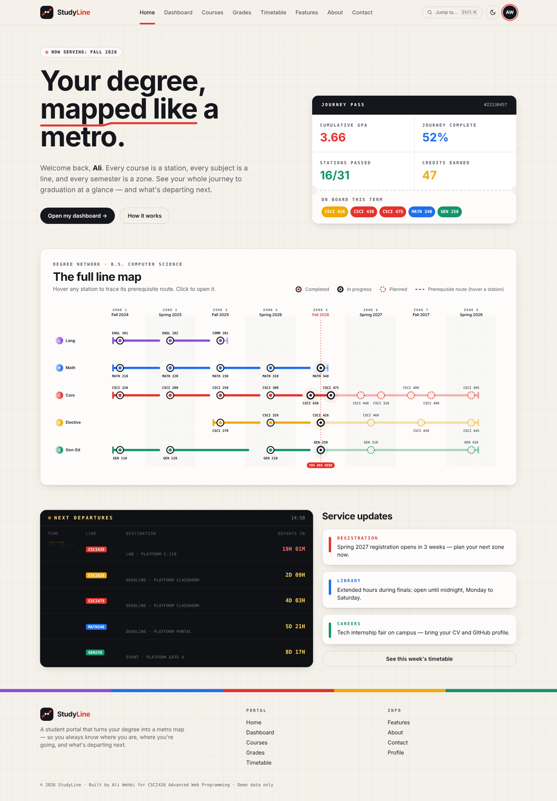
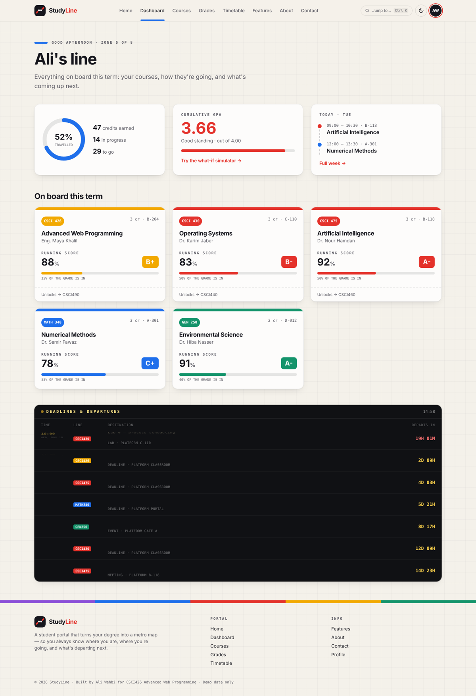
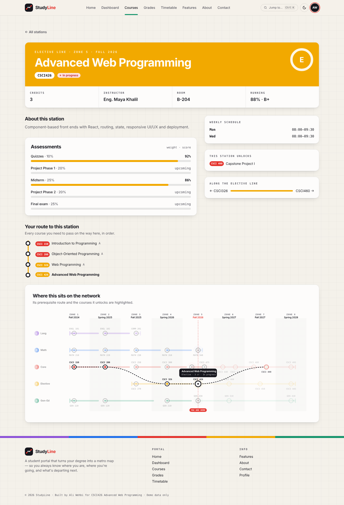
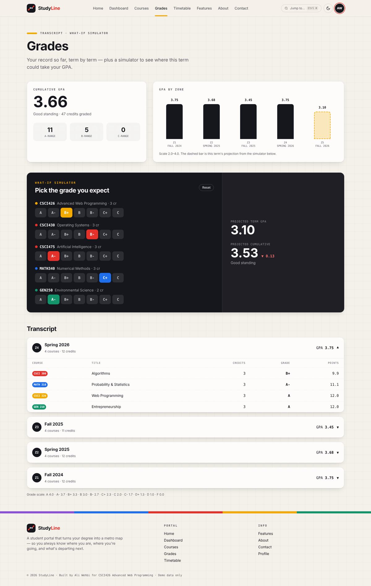
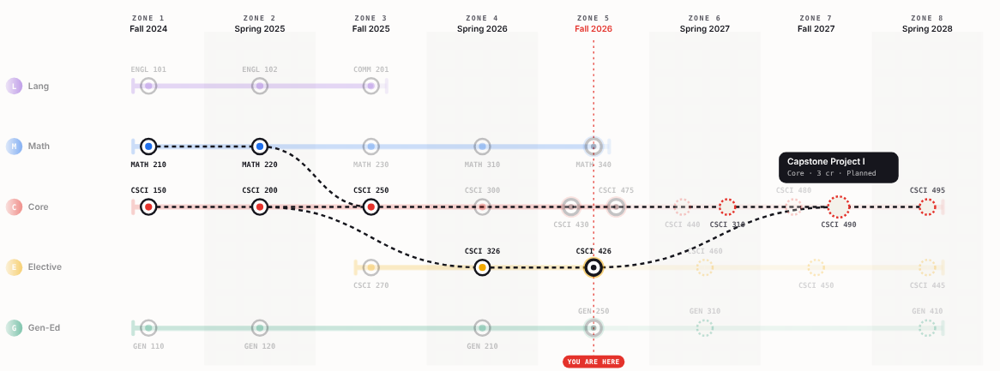
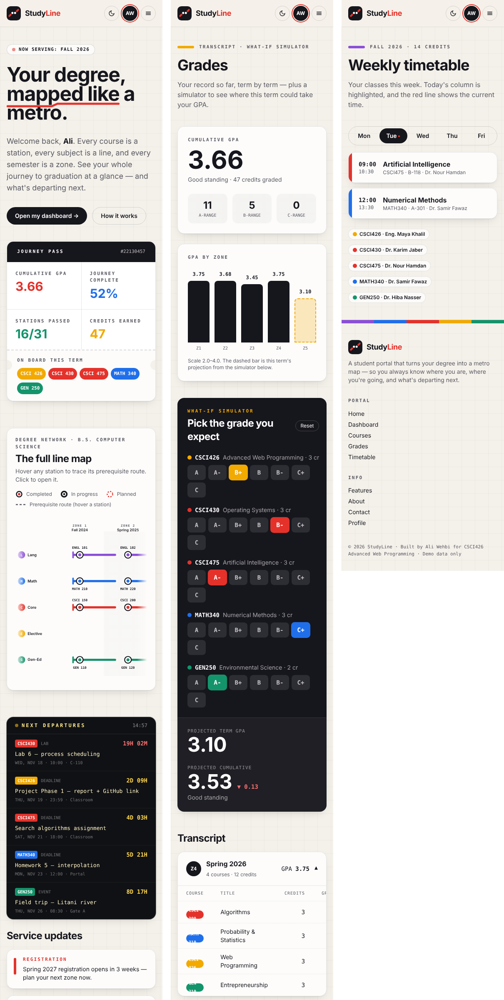

# 🚇 StudyLine — a student portal that maps your degree like a metro

**StudyLine** is a React student portal built around one idea: a degree is a journey, so show it the way
transit maps show journeys. Every **course is a station**, every **subject area is a coloured line**, and every
**semester is a zone**. Students can see where they are, what's required to get somewhere, and what's
"departing" next — at a glance.

> CSCI426 Advanced Web Programming · Project Phase 1 · Fall 2026 · Ali Wehbi

**Live demo:** `https://<your-username>.github.io/studyline/` *(update after deploying)*



---

## ✨ Features

| Feature | What it does |
|---|---|
| **Degree transit map** | Hand-built interactive SVG of the whole programme. Completed, in-progress and planned courses each have their own station style. A "You are here" marker shows the current semester. |
| **Prerequisite routing** | Hover/focus any station to light up its full prerequisite route and the courses it unlocks. |
| **Departure board** | Upcoming deadlines styled as a split-flap station board with live countdowns (red when under 48 h). |
| **What-if GPA simulator** | Pick the grade you expect in each current course and see projected term + cumulative GPA instantly. |
| **Live timetable** | Weekly grid with today's column highlighted, a current-time line and a "NOW" badge; day tabs on mobile. |
| **Dynamic course pages** | `/courses/:code` — station sign, assessments, running score, route, unlocks and neighbours on the same line. |
| **Quick jump (Ctrl/⌘ + K)** | Command palette to search any page or course with the keyboard. |
| **Night service** | Dark mode, remembered between visits. |
| **Profile** | Editable student details shown on a "journey pass" card; saved to `localStorage`. |
| **Contact form** | Client-side validation and a generated support ticket. |

## 📄 Pages

| Route | Page |
|---|---|
| `/` | **Home** — hero, journey pass, full line map, departures, service updates |
| `/dashboard` | **Dashboard** — progress ring, GPA, today's classes, current course tickets |
| `/courses` | **Courses** — searchable/filterable list or map view |
| `/courses/:code` | **Course detail** *(dynamic page)* |
| `/grades` | **Grades** — GPA chart, what-if simulator, transcript |
| `/timetable` | **Timetable** — weekly schedule |
| `/features` | **Features / Services** |
| `/about` | **About** |
| `/contact` | **Contact** |
| `/profile` | **Profile** |
| `*` | **404** — "End of the line" |

## 🛠 Technologies

- **React 18** (function components, hooks, Context API)
- **React Router 6** (`HashRouter` so deep links work on GitHub Pages)
- **Tailwind CSS 3** (responsive utilities, `dark:` mode, custom theme)
- **Vite 5** (dev server and build)
- **SVG** drawn by hand for the map, charts and illustrations — no chart or UI template libraries
- **localStorage** for persistence

## 📁 Project structure

```
src/
├── components/
│   ├── TransitMap.jsx       # interactive SVG degree map (core feature)
│   ├── DepartureBoard.jsx   # live deadline board
│   ├── CommandPalette.jsx   # Ctrl+K quick jump
│   ├── Layout.jsx           # header, mobile menu, footer
│   ├── nav.js               # navigation config
│   └── ui.jsx               # Roundel, Ring, Bar, PageHeader, StatusChip…
├── context/StudentContext.jsx  # profile, what-if grades, theme (+ localStorage)
├── data/
│   ├── courses.js           # courses, lines, terms, timetable + route helpers
│   └── events.js            # deadlines (relative to today) and announcements
├── lib/grades.js            # GPA maths, letter grades, running scores
├── pages/                   # one file per route
├── App.jsx                  # routes
└── main.jsx                 # entry point
```

## 🚀 Setup

Requirements: **Node.js 18+** and npm.

```bash
git clone https://github.com/<your-username>/studyline.git
cd studyline
npm install
npm run dev        # http://localhost:5173
```

Production build:

```bash
npm run build      # outputs to dist/
npm run preview    # serve the build locally
```

## 🌐 Deployment

**GitHub Pages (automatic):** this repo includes `.github/workflows/deploy.yml`.
1. Push to a GitHub repo on the `main` branch.
2. Go to **Settings → Pages → Build and deployment → Source** and choose **GitHub Actions**.
3. Every push to `main` builds and deploys. The URL appears in the Actions run.

**Netlify / Vercel:** import the repo, build command `npm run build`, output directory `dist`.

## 🖼 Screenshots

| Dashboard | Course detail (dynamic) |
|---|---|
|  |  |

| Grades + what-if simulator | Prerequisite route highlight |
|---|---|
|  |  |

**Mobile**



## 💡 Design notes

- **Metaphor everywhere:** deadlines → departures, semesters → zones, student card → journey pass, 404 → end of the line.
- **Colour = meaning:** each subject line keeps its colour on every page (badges, tickets, timetable blocks).
- **Accessibility:** keyboard-focusable map stations, skip-to-content link, visible focus rings, `prefers-reduced-motion` respected.
- **Original work:** the design and every component were written from scratch for this project; no templates were used.
  Fonts: Space Grotesk, Inter and JetBrains Mono (Google Fonts, SIL Open Font License).

All student and course data is fictional demo data.

> Project by Ali Wehbi (LIU student). Code and functionality implemented by Ali Wehbi; styling implemented with AI assistance.
